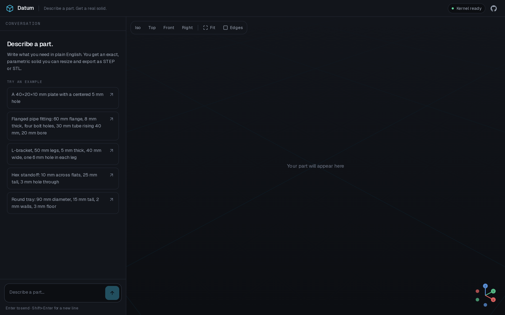
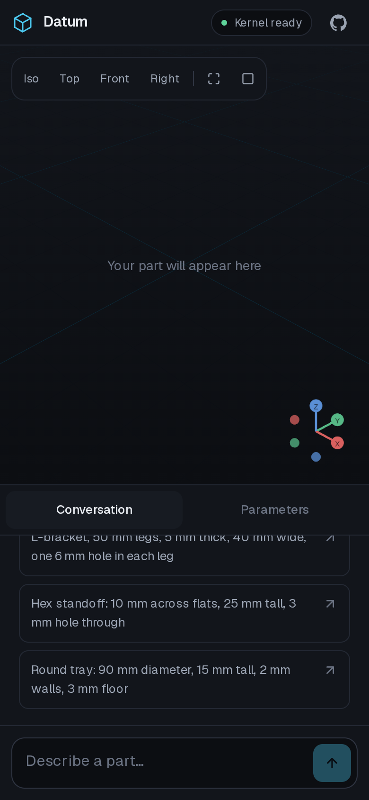
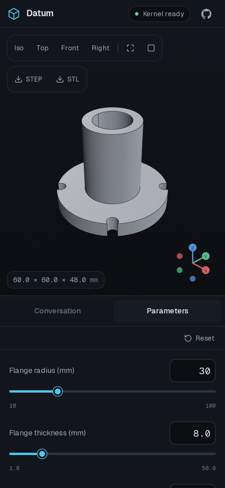

<p align="center">
  <picture>
    <source media="(max-width: 600px)" srcset="docs/readme/sheet-mobile.svg">
    
  </picture>
</p>

<p align="center"><b><a href="https://datum.ashiswadhwani.in">datum.ashiswadhwani.in</a></b> · describe a part, get a real solid</p>

<details>
<summary><b>More views</b></summary>
<br>
<table>
<tr>
<td align="center" width="60%"><br><sub>Empty workbench with example prompts</sub></td>
<td align="center" width="20%"><br><sub>Phone</sub></td>
<td align="center" width="20%"><br><sub>Parameters tab</sub></td>
</tr>
</table>
</details>

---

## How it works

```
prompt ──▶ /api/generate ──▶ Gemini 2.5 Flash-Lite ──▶ { code, params, notes }
                (server; holds the key)                         │
                                                                ▼
             Web Worker: Replicad + OpenCascade (WASM) ──▶ exact BREP solid
                     │                                         │
                     ▼                                         ▼
          mesh ──▶ three.js viewport                 STEP / STL download
```

- **The BREP solid is the source of truth.** The viewport shows a mesh of it; exports come from the solid itself.
- **Sliders never call the AI.** Every dimension the model declares becomes a parameter, and dragging one re-runs the same code in the worker.
- **Broken code fixes itself.** If the kernel rejects the generated code, the decoded error and the code go back to the model, up to two retries.
- **The key never reaches the browser.** The Gemini key lives in the server route only.

## Run it locally

Needs Node 20+ and a [Google AI Studio](https://aistudio.google.com/apikey) key (the free tier works).

```bash
npm install
cp .env.example .env.local      # then set GEMINI_API_KEY in .env.local
npm run dev                     # http://localhost:3000
```

| Variable | Required | Default | What it does |
|---|---|---|---|
| `GEMINI_API_KEY` | yes | | Server-side key for the generate route |
| `GEMINI_MODEL` | no | `gemini-2.5-flash-lite` | Model id, if you want a different one |
| `RATE_LIMIT_PER_MINUTE` | no | `8` | Generate requests per IP per minute |
| `RATE_LIMIT_PER_DAY` | no | `60` | Generate requests per IP per day |
| `NEXT_PUBLIC_SITE_URL` | no | `http://localhost:3000` | Absolute URL used for Open Graph images |

## Deploy on Vercel

It's a plain Next.js app at the repo root, so no config file is needed:

1. Import the repo in Vercel (framework preset: Next.js).
2. Add `GEMINI_API_KEY` and `NEXT_PUBLIC_SITE_URL` (for this deployment, `https://datum.ashiswadhwani.in`) under Environment Variables.
3. Deploy. Every push to `master` redeploys production.

The 10.8 MB OpenCascade WASM ships from `public/` as a static file; all CAD work runs in the visitor's browser, so the server only proxies the model call.

## Scripts

| Command | |
|---|---|
| `npm run dev` | Dev server |
| `npm run build` / `npm start` | Production build and server |
| `npm test` | Vitest: self-correction loop, output sanitising, rate limiter, API route |
| `npm run lint` · `npm run typecheck` | ESLint · TypeScript |

## Project layout

```
app/
  api/generate/route.ts   POST: validate, rate-limit, call Gemini, map errors
  api/health/route.ts     GET: status, model, whether a key is set
  page.tsx · layout.tsx   the workbench page, metadata, OG image, icon
components/cad/           CadStage (layout), useCadSession (state), Viewport,
                          Conversation, ParamPanel, ViewportToolbar, TopBar
lib/
  server/                 gemini.ts, systemPrompt.ts (Replicad cheatsheet),
                          sanitize.ts, rateLimit.ts
  replicad/               kernel.worker.ts, kernel.ts, kernelClient.ts, mesh.ts
  selfCorrect.ts          generate → build → retry with the decoded error
  api.ts                  browser client + shared error codes
public/replicad_single.wasm   OpenCascade compiled to WebAssembly
docs/                     original spec, build log, README image tooling
```

## Limits worth knowing

- **Free-tier quota.** Gemini's free tier allows about 20 generations a day for Flash-Lite. Slider changes are free; each self-correction retry costs one generation.
- **Rate limiting is per server instance.** It stops casual abuse; for a busy public deployment, also put a limit in front (for example Vercel's firewall rules).
- **Generated code runs in your browser.** It runs inside the Web Worker with network and messaging globals hidden from it and a 20-second build timeout, but it is still model-written JavaScript.
- **Simple and medium parts work best.** One to a few features (plates, brackets, flanges, standoffs, trays) build reliably. Dense parts with many interacting fillets may need a follow-up prompt.

## Regenerating the README images

```bash
cd docs/readme
npm install --no-save --no-package-lock playwright && npx playwright install chromium   # once
node shoot.cjs          # needs the app running at http://localhost:3000; reuses shots/fixture.json
python3 make_svg.py     # rebuilds sheet.svg + sheet-mobile.svg
```

`shoot.cjs` only calls Gemini when `shots/fixture.json` is missing; delete it to draw a new part.

## License

[MIT](LICENSE) © 2026 Ashis Wadhwani
